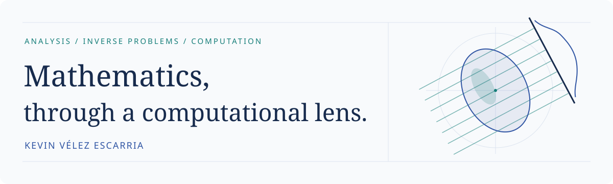
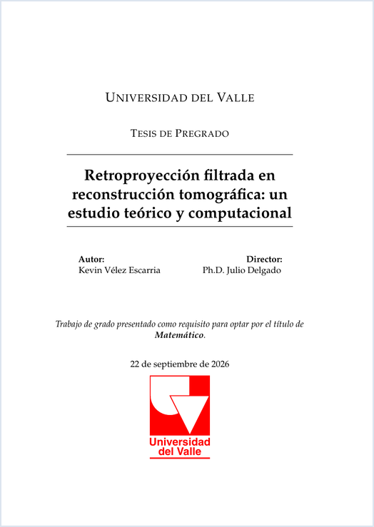
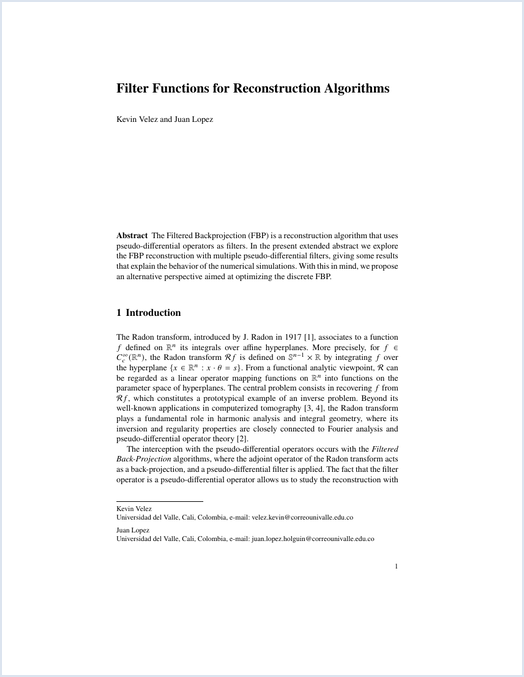

<picture>
  <source media="(prefers-color-scheme: dark)" srcset="assets/header-dark.svg">
  <source media="(prefers-color-scheme: light)" srcset="assets/header-light.svg">
  
</picture>

# Kevin Vélez Escarria

**Mathematician · Backend Developer · Colombia**

I am a mathematician from **Universidad del Valle**, interested in graduate study
and mathematical research. My current work connects **Fourier analysis, inverse
problems and scientific computing**: from mathematical reasoning to numerical
experiments and reproducible software.

[Contact me](mailto:velez.kevin@correounivalle.edu.co) · [Selected work](#selected-work) · [Background](#background)

## Selected work

### 01 / Filtered backprojection in tomographic reconstruction

**Undergraduate thesis · Spanish · 36 pages** 
*Retroproyección filtrada en reconstrucción tomográfica: un estudio teórico y computacional*

A theoretical and computational study of two-dimensional reconstruction through
the Radon transform and filtered backprojection, including numerical experiments
on reconstruction filters and sensitivity to noise. Supervised by **Julio Delgado**.

**[Read thesis](papers/tesis.pdf)** · [Download PDF](https://github.com/KevinVelezE/KevinVelezE/raw/refs/heads/main/papers/tesis.pdf)

---

### 02 / Filter Functions for Reconstruction Algorithms

**MAPI 4 (2026) · Extended abstract · English · 6 pages** 
Kevin Velez and **Juan Lopez**

Fourier multiplier symbols and their role in reconstruction algorithms.
Accompanied by a conference presentation at MAPI 4.

**[Read abstract](papers/mapi4-abstract.pdf)** · [Download PDF](https://github.com/KevinVelezE/KevinVelezE/raw/refs/heads/main/papers/mapi4-abstract.pdf)

## Background

<strong>Education — mathematics &amp; electronics</strong>

- **Mathematician** — Universidad del Valle, Colombia.
- **Technologist in Electronics** — Universidad del Valle, Colombia.

My interests bring together analysis, numerical experimentation and the practical
work of building computational tools.

<strong>Software practice — Backend Developer at Numera, since 2024</strong>

Alongside mathematics, I develop backend systems for accounting operations,
electronic invoicing, tax workflows, inventory management and integrations with
accounting and ERP software.

My day-to-day tools include **Python, databases, Redis, Docker and AWS**.
I am interested in bringing this experience to reproducible mathematical software
and accessible computational tools.

---

**Let's talk mathematics and computation.** 
[velez.kevin@correounivalle.edu.co](mailto:velez.kevin@correounivalle.edu.co)
